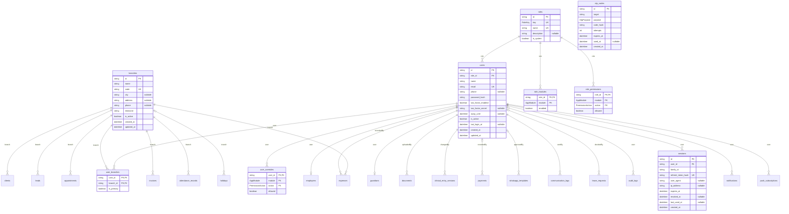
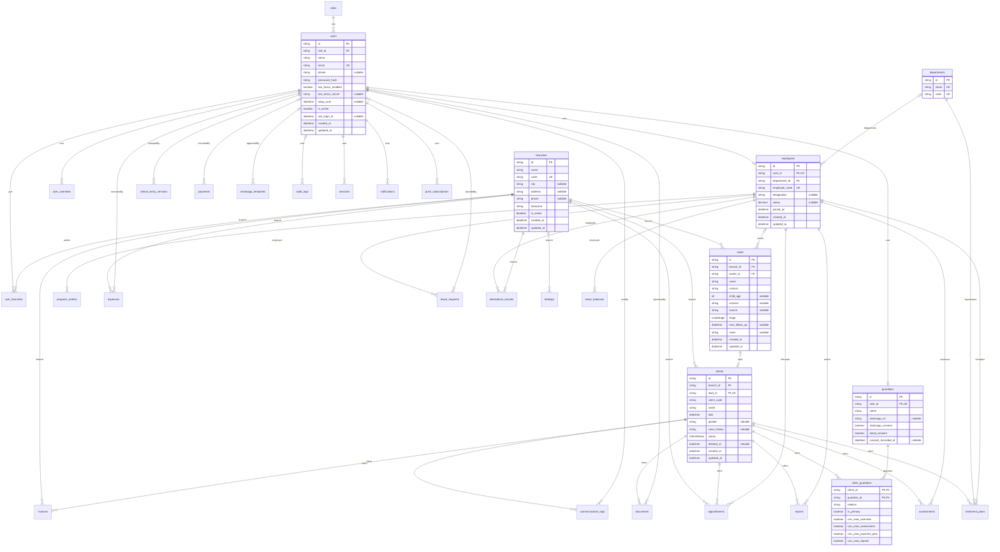
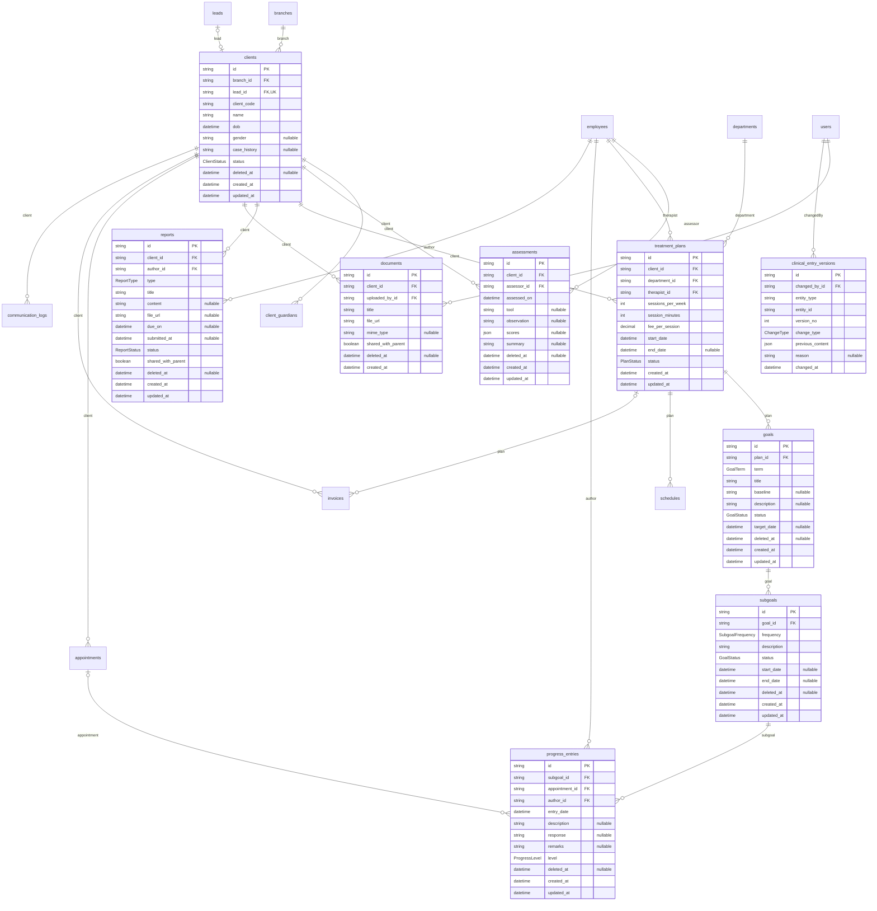
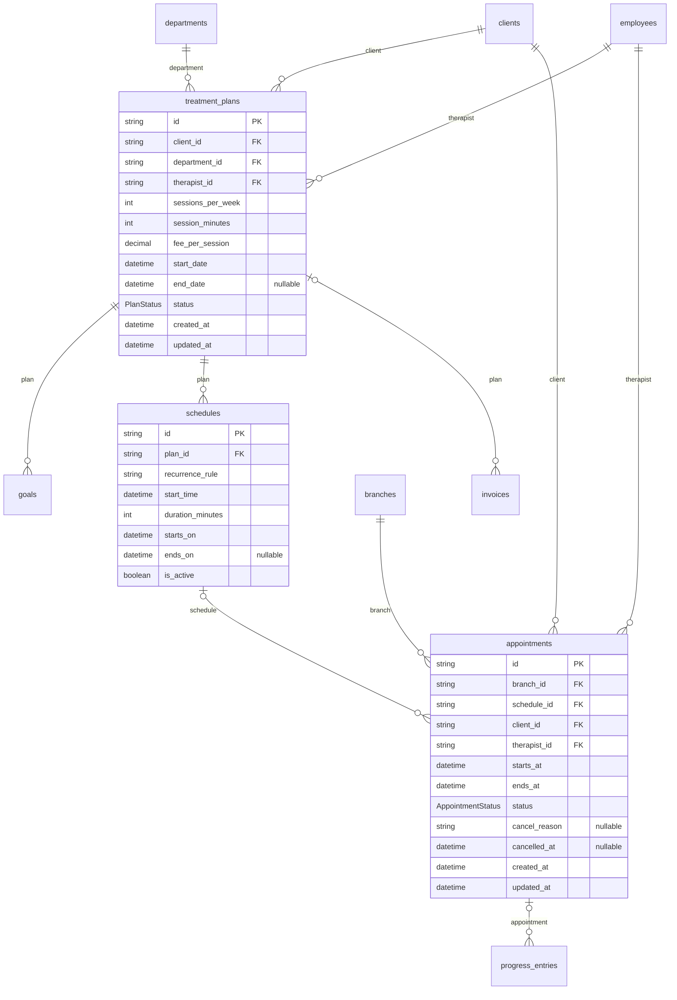
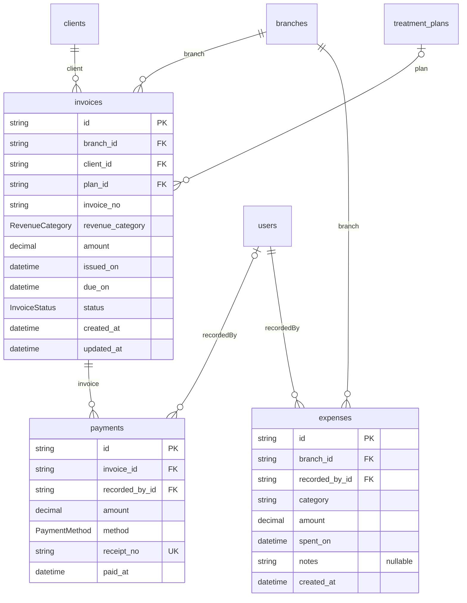
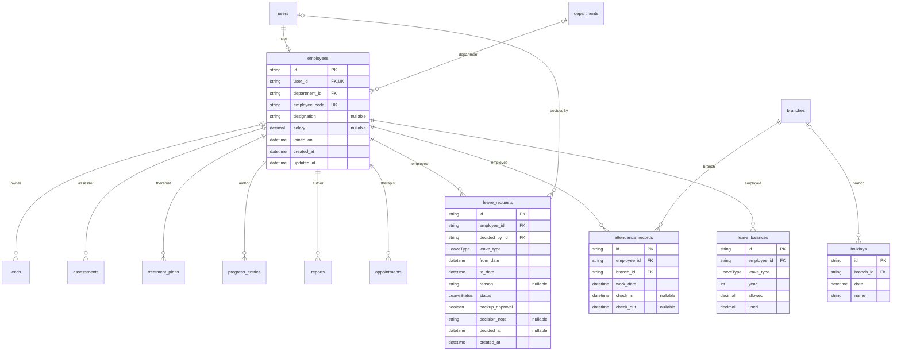
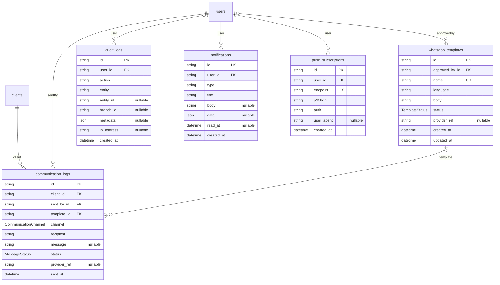

# Entity Relationship Diagram

Petals Child Development Centre ERP. This file matches `apps/api/prisma/schema.prisma` (37 tables). Table and column names are the real PostgreSQL names (snake_case). If you change the schema, update this file in the same commit.

Mermaid diagrams render on GitHub and in most Markdown viewers. If yours does not render them, paste the code into https://mermaid.live.

## How to read the diagrams

- `PK` primary key, `FK` foreign key, `UK` unique. Fields marked `nullable` may be empty.
- `||--o{` means one to many. `|o--o{` means the parent is optional. `||--o|` means one to at most one.
- Enum columns show the enum name as their type (for example `AppointmentStatus`); the values are in `schema.prisma`.
- Entities shown without columns in a section diagram belong to another section.

## Key design rules

- **No rooms:** there is no room entity. Every department has its own room, so a session's location is implied by its department and branch.
- **Branches:** a client belongs to exactly one branch. Users reach branches through `user_branches`. Branch-owned tables carry `branch_id` and are protected by the Prisma branch extension and PostgreSQL row-level security.
- **Permissions:** module toggle in `role_modules`, actions in `role_permissions`, per-user exceptions in `user_overrides`. Roles are identified by the stable `key`, not the display name.
- **Sessions:** the JWT carries only the user id and the `sessions.id`. The refresh token is stored as a hash, and `family_id` groups a rotation chain.
- **Clinical data:** soft delete with `deleted_at`. Every edit, delete or restore writes a row to `clinical_entry_versions` in the same transaction.
- **Money:** amounts are `decimal`. Revenue category lives on `invoices`; payments settle invoices. Parents see payment status only.
- **Time:** all timestamps are UTC; `branches.timezone` is used for display.
- **Pagination:** append-heavy tables (`audit_logs`, `communication_logs`, `clinical_entry_versions`) have a `(created/sent/changed time, id)` index for cursor pagination.

## Full diagram

```mermaid
erDiagram
  users ||--o{ user_branches : user
  branches ||--o{ user_branches : branch
  roles ||--o{ role_modules : role
  roles ||--o{ role_permissions : role
  users ||--o{ user_overrides : user
  roles ||--o{ users : role
  users ||--o| employees : user
  departments |o--o{ employees : department
  users ||--o| guardians : user
  branches ||--o{ clients : branch
  leads |o--o| clients : lead
  clients ||--o{ client_guardians : client
  guardians ||--o{ client_guardians : guardian
  branches ||--o{ leads : branch
  employees |o--o{ leads : owner
  clients ||--o{ assessments : client
  employees ||--o{ assessments : assessor
  clients ||--o{ treatment_plans : client
  departments ||--o{ treatment_plans : department
  employees ||--o{ treatment_plans : therapist
  treatment_plans ||--o{ goals : plan
  goals ||--o{ subgoals : goal
  subgoals ||--o{ progress_entries : subgoal
  appointments |o--o{ progress_entries : appointment
  employees ||--o{ progress_entries : author
  clients ||--o{ reports : client
  employees ||--o{ reports : author
  clients ||--o{ documents : client
  users ||--o{ documents : uploadedBy
  users ||--o{ clinical_entry_versions : changedBy
  treatment_plans ||--o{ schedules : plan
  branches ||--o{ appointments : branch
  schedules |o--o{ appointments : schedule
  clients ||--o{ appointments : client
  employees ||--o{ appointments : therapist
  branches ||--o{ invoices : branch
  clients ||--o{ invoices : client
  treatment_plans |o--o{ invoices : plan
  invoices ||--o{ payments : invoice
  users |o--o{ payments : recordedBy
  branches ||--o{ expenses : branch
  users ||--o{ expenses : recordedBy
  users |o--o{ whatsapp_templates : approvedBy
  clients ||--o{ communication_logs : client
  users ||--o{ communication_logs : sentBy
  whatsapp_templates |o--o{ communication_logs : template
  employees ||--o{ leave_requests : employee
  users |o--o{ leave_requests : decidedBy
  employees ||--o{ attendance_records : employee
  branches ||--o{ attendance_records : branch
  users |o--o{ audit_logs : user
  users ||--o{ sessions : user
  branches |o--o{ holidays : branch
  employees ||--o{ leave_balances : employee
  users ||--o{ notifications : user
  users ||--o{ push_subscriptions : user

  branches {
    string id PK
    string name
    string code UK
    string city "nullable"
    string address "nullable"
    string phone "nullable"
    string timezone
    boolean is_active
    datetime created_at
    datetime updated_at
  }
  user_branches {
    string user_id PK, FK
    string branch_id PK, FK
    boolean is_primary
  }
  roles {
    string id PK
    RoleKey key UK
    string name UK
    string description "nullable"
    boolean is_system
  }
  role_modules {
    string role_id PK, FK
    AppModule module PK
    boolean enabled
  }
  role_permissions {
    string role_id PK, FK
    AppModule module PK
    PermissionAction action PK
    boolean allowed
  }
  user_overrides {
    string user_id PK, FK
    AppModule module PK
    PermissionAction action PK
    boolean allowed
  }
  users {
    string id PK
    string role_id FK
    string name
    string email UK
    string phone "nullable"
    string password_hash
    boolean two_factor_enabled
    string two_factor_secret "nullable"
    datetime away_until "nullable"
    boolean is_active
    datetime last_login_at "nullable"
    datetime created_at
    datetime updated_at
  }
  departments {
    string id PK
    string name UK
    string code UK
  }
  employees {
    string id PK
    string user_id FK, UK
    string department_id FK
    string employee_code UK
    string designation "nullable"
    decimal salary "nullable"
    datetime joined_on
    datetime created_at
    datetime updated_at
  }
  guardians {
    string id PK
    string user_id FK, UK
    string name
    string whatsapp_no "nullable"
    boolean whatsapp_consent
    boolean email_consent
    datetime consent_recorded_at "nullable"
  }
  clients {
    string id PK
    string branch_id FK
    string lead_id FK, UK
    string client_code
    string name
    datetime dob
    string gender "nullable"
    string case_history "nullable"
    ClientStatus status
    datetime deleted_at "nullable"
    datetime created_at
    datetime updated_at
  }
  client_guardians {
    string client_id PK, FK
    string guardian_id PK, FK
    string relation
    boolean is_primary
    boolean can_view_overview
    boolean can_view_assessment
    boolean can_view_payment_plan
    boolean can_view_reports
  }
  leads {
    string id PK
    string branch_id FK
    string owner_id FK
    string name
    string contact
    int child_age "nullable"
    string concern "nullable"
    string source "nullable"
    LeadStage stage
    datetime next_follow_up "nullable"
    string notes "nullable"
    datetime created_at
    datetime updated_at
  }
  assessments {
    string id PK
    string client_id FK
    string assessor_id FK
    datetime assessed_on
    string tool "nullable"
    string observation "nullable"
    json scores "nullable"
    string summary "nullable"
    datetime deleted_at "nullable"
    datetime created_at
    datetime updated_at
  }
  treatment_plans {
    string id PK
    string client_id FK
    string department_id FK
    string therapist_id FK
    int sessions_per_week
    int session_minutes
    decimal fee_per_session
    datetime start_date
    datetime end_date "nullable"
    PlanStatus status
    datetime created_at
    datetime updated_at
  }
  goals {
    string id PK
    string plan_id FK
    GoalTerm term
    string title
    string baseline "nullable"
    string description "nullable"
    GoalStatus status
    datetime target_date "nullable"
    datetime deleted_at "nullable"
    datetime created_at
    datetime updated_at
  }
  subgoals {
    string id PK
    string goal_id FK
    SubgoalFrequency frequency
    string description
    GoalStatus status
    datetime start_date "nullable"
    datetime end_date "nullable"
    datetime deleted_at "nullable"
    datetime created_at
    datetime updated_at
  }
  progress_entries {
    string id PK
    string subgoal_id FK
    string appointment_id FK
    string author_id FK
    datetime entry_date
    string description "nullable"
    string response "nullable"
    string remarks "nullable"
    ProgressLevel level
    datetime deleted_at "nullable"
    datetime created_at
    datetime updated_at
  }
  reports {
    string id PK
    string client_id FK
    string author_id FK
    ReportType type
    string title
    string content "nullable"
    string file_url "nullable"
    datetime due_on "nullable"
    datetime submitted_at "nullable"
    ReportStatus status
    boolean shared_with_parent
    datetime deleted_at "nullable"
    datetime created_at
    datetime updated_at
  }
  documents {
    string id PK
    string client_id FK
    string uploaded_by_id FK
    string title
    string file_url
    string mime_type "nullable"
    boolean shared_with_parent
    datetime deleted_at "nullable"
    datetime created_at
  }
  clinical_entry_versions {
    string id PK
    string changed_by_id FK
    string entity_type
    string entity_id
    int version_no
    ChangeType change_type
    json previous_content
    string reason "nullable"
    datetime changed_at
  }
  schedules {
    string id PK
    string plan_id FK
    string recurrence_rule
    datetime start_time
    int duration_minutes
    datetime starts_on
    datetime ends_on "nullable"
    boolean is_active
  }
  appointments {
    string id PK
    string branch_id FK
    string schedule_id FK
    string client_id FK
    string therapist_id FK
    datetime starts_at
    datetime ends_at
    AppointmentStatus status
    string cancel_reason "nullable"
    datetime cancelled_at "nullable"
    datetime created_at
    datetime updated_at
  }
  invoices {
    string id PK
    string branch_id FK
    string client_id FK
    string plan_id FK
    string invoice_no
    RevenueCategory revenue_category
    decimal amount
    datetime issued_on
    datetime due_on
    InvoiceStatus status
    datetime created_at
    datetime updated_at
  }
  payments {
    string id PK
    string invoice_id FK
    string recorded_by_id FK
    decimal amount
    PaymentMethod method
    string receipt_no UK
    datetime paid_at
  }
  expenses {
    string id PK
    string branch_id FK
    string recorded_by_id FK
    string category
    decimal amount
    datetime spent_on
    string notes "nullable"
    datetime created_at
  }
  whatsapp_templates {
    string id PK
    string approved_by_id FK
    string name UK
    string language
    string body
    TemplateStatus status
    string provider_ref "nullable"
    datetime created_at
    datetime updated_at
  }
  communication_logs {
    string id PK
    string client_id FK
    string sent_by_id FK
    string template_id FK
    CommunicationChannel channel
    string recipient
    string message "nullable"
    MessageStatus status
    string provider_ref "nullable"
    datetime sent_at
  }
  leave_requests {
    string id PK
    string employee_id FK
    string decided_by_id FK
    LeaveType leave_type
    datetime from_date
    datetime to_date
    string reason "nullable"
    LeaveStatus status
    boolean backup_approval
    string decision_note "nullable"
    datetime decided_at "nullable"
    datetime created_at
  }
  attendance_records {
    string id PK
    string employee_id FK
    string branch_id FK
    datetime work_date
    datetime check_in "nullable"
    datetime check_out "nullable"
  }
  audit_logs {
    string id PK
    string user_id FK
    string action
    string entity
    string entity_id "nullable"
    string branch_id "nullable"
    json metadata "nullable"
    string ip_address "nullable"
    datetime created_at
  }
  sessions {
    string id PK
    string user_id FK
    string family_id
    string refresh_token_hash UK
    string user_agent "nullable"
    string ip_address "nullable"
    datetime expires_at
    datetime revoked_at "nullable"
    datetime last_used_at "nullable"
    datetime created_at
  }
  otp_codes {
    string id PK
    string target
    OtpPurpose purpose
    string code_hash
    int attempts
    datetime expires_at
    datetime used_at "nullable"
    datetime created_at
  }
  holidays {
    string id PK
    string branch_id FK
    datetime date
    string name
  }
  leave_balances {
    string id PK
    string employee_id FK
    LeaveType leave_type
    int year
    decimal allowed
    decimal used
  }
  notifications {
    string id PK
    string user_id FK
    string type
    string title
    string body "nullable"
    json data "nullable"
    datetime read_at "nullable"
    datetime created_at
  }
  push_subscriptions {
    string id PK
    string user_id FK
    string endpoint UK
    string p256dh
    string auth
    string user_agent "nullable"
    datetime created_at
  }
```

## Diagrams by area

### Access control and identity

### Branches, people and leads

### Clinical records

### Scheduling

### Finance

### HR

### Communication and system

## Table reference

| Table | Purpose |
|---|---|
| `appointments` | Individual sessions; cancelled ones stay visible |
| `assessments` | Assessment records and observations |
| `attendance_records` | Staff check-in and check-out |
| `audit_logs` | Who did what to which entity |
| `branches` | Clinic branches (own timezone) |
| `client_guardians` | Links guardians to children with visibility flags |
| `clients` | Children; each belongs to one branch |
| `clinical_entry_versions` | Version history of edited, deleted or restored clinical entries |
| `communication_logs` | Every WhatsApp, email or call record |
| `departments` | Therapy types (Speech, OT, PT, ABA, Psychotherapy) |
| `documents` | Uploaded files with parent sharing flag |
| `employees` | Staff profile, salary, department |
| `expenses` | Branch expenses for the P&L |
| `goals` | Long and short term goals with baseline |
| `guardians` | Parent/guardian accounts and consent |
| `holidays` | Holidays per branch or for all branches |
| `invoices` | Billing with revenue category and status |
| `leads` | Enquiries before they become clients |
| `leave_balances` | Leave balance per employee, type and year |
| `leave_requests` | Leave requests, decisions and backup approval |
| `notifications` | In-app and parent-portal notifications |
| `otp_codes` | One-time codes for parent login |
| `payments` | Payments against invoices |
| `progress_entries` | Description, response, remarks and progress per sub-goal |
| `push_subscriptions` | Web Push subscriptions for the PWA |
| `reports` | Clinical reports with status and parent sharing |
| `role_modules` | Module On/Off toggle per role |
| `role_permissions` | Create/Update/View/View All/Delete per role and module |
| `roles` | The four system roles (stable key) |
| `schedules` | Recurring session rules |
| `sessions` | One row per login; refresh token stored as hash |
| `subgoals` | Daily, weekly and monthly sub-goals |
| `treatment_plans` | Plan per client, department and therapist |
| `user_branches` | Which branches a user can access |
| `user_overrides` | Per-user permission exceptions |
| `users` | Login identity for every person |
| `whatsapp_templates` | WhatsApp templates and approval status |

## Notes and open items

- `expenses.category` is free text until the P&L expense categories are decided.
- `clinical_entry_versions` uses a generic `entity_type` and `entity_id` instead of foreign keys to each clinical table, so the application must keep that link correct.
- Payments get their branch through `invoices`; `payments` has no `branch_id` of its own.
- `users.away_until` is how the Director is marked unavailable so a Manager can approve leave as backup.
